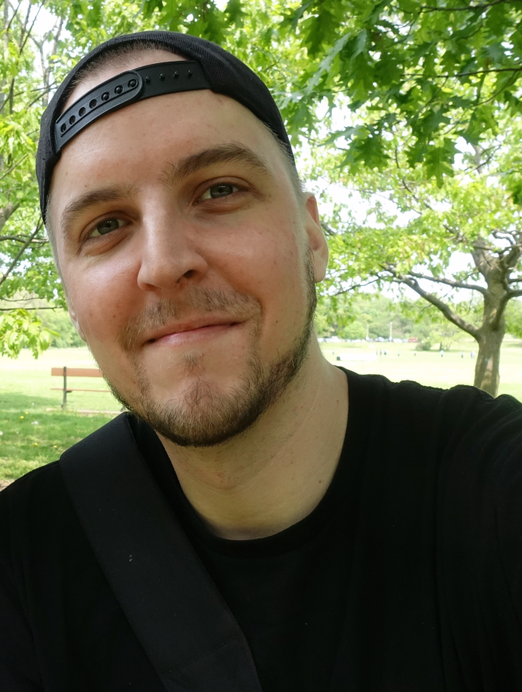

 

I'm a **Toronto-based** *game designer* with over a decade of proven *experience*. I've *worked as a designer at studios in both indie and AAA contexts*, shipping titles such as *[Far Cry 6](https://www.ubisoft.com/en-ca/game/far-cry/far-cry-6) and [Riverbond](https://cococucumber.co/riverbond/)*, to name a few. 

I also have experience working as a *lead and a director*, coordinating and communicating design intent to deliver experiences for a target audience and developing production plans - I also *teach Collaborative Game Development at York University*! I champion *efficient production practices*, prioritizing both the target player's experience as well as advocating *the well-being of the team I work with*.

In addition *I have developed and shipped [five of my own games](https://store.steampowered.com/developer/devsgames) working in a solo capacity*, handling every single aspect of development from programming to art.

*​English* is my native language, but I speak fluent *Pig-Latin* as well as some core *French*. I can also read the Korean alphabet (I just might not be able to tell you what it means).

If you see anything of interest on my site or know of a project I can help you with, **please reach out and let's have a chat**. :)

### Email: [devonwiersma8@gmail.com](mailto:devonwiersma8@gmail.com)
### Linkedin: [https://www.linkedin.com/in/devon-wiersma/](https://www.linkedin.com/in/devon-wiersma/) 