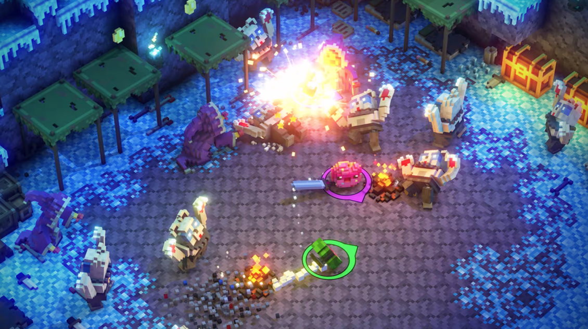

 

# **Unannounced Title, Cat Samurai Games**
## Game Design Director (2024 - Present)
###### [Studio Website](https://www.catsamuraigames.com/) 

- *Directed the design* of a casual, cozy game at a small indie studio.
- *Supervised and assisted junior designers* to develop their learning plans while providing feedback, accountability, and oversight of their professional development.
- *Designed, pitched and provided direction* for features and levels from initial creative concept to completion.
- *Created and maintained project timelines, team tasks and risks/priorities* to ensure the project is on time and to-quality.
- Managed a wide range of various tasks and responsibilities as needed to *get everyone what they need to make a great game*.

 

## **Various Projects, Dev’s Games**
### Solo Developer (2020 - Present)
###### [All Projects (Steam)](https://store.steampowered.com/developer/devsgames) | [All Projects (Itch.io)](https://devonwiersma.itch.io/) 

- *Self-published*, *solo developed* and shipped **six** games in both digital and non-digital formats. 
- I manage *every aspect* of my own productions, including *design, art, and programming*.
- Independently produced, designed, documented, marketed games in a *wide variety of genres*.
- Ran and delivered a *successfully funded Kickstarter*.

 

## **Course Director, York University**
### (2024 - Present)

- *Presented lectures and supervised group work* for classes of ~50 students for the Collaborative Game Development course, focused on *efficient collaborative game production practices*.
- *Consistently provided mentorship, production advice and career guidance* to emerging game developers.
- *Taught a wide range of concepts* ranging from introductory lessons on game development fundamentals, to larger topics such as planning a game's production.

 

## **Cancelled Project, The Beans Team**
### Sr. Level Designer (2021 - 2023)
###### [Studio Website](https://www.thebeansteam.com/) 

- Designed levels in an *Unreal Engine* game in partnership with *Devolver Digital*.
- Lead the design and *established level design direction* of various gameplay spaces.
- *Designed layouts*, *modelled geometry*, *designed lighting* and iterated on levels around a *unique combat mechanic*.
- Coordinated the development of *core gameplay systems and production pipelines*.

 

## **Far Cry 6, Ubisoft Toronto**
### Level Designer (2018 - 2021)
###### [Game Site](https://www.ubisoft.com/en-us/game/far-cry/far-cry-6) 

- Designed and iterated on levels for a first-person game from *initial concept through to ship*.
- *Collaborated* with programmers, artists and other designers of various specializations to create compelling gameplay.
- Implemented gameplay sequences and AI encounters with *proprietary visual scripting* software.

 

## **Riverbond, Cococucumber**
### Level Designer (2017)
###### [Game Site](https://cococucumber.co/riverbond/) 

- Designed *isometric, non-linear levels* on a *multiplayer* game targetting a *casual* audience for PC and consoles.
- Riverbond won numerous awards, including *Official Selection PAX West* and *Best in Play at GDC 2017*.

 

## **Dragon of Legends, Thrive Games**
### Level Designer (2016)
###### [Kickstarter Page](https://www.kickstarter.com/projects/thrivegames/dol) 

- Designed *tile-based levels* for a *mobile MMORPG*.
- *Improved pipelines* to optimize the team's production process and delivery.

---